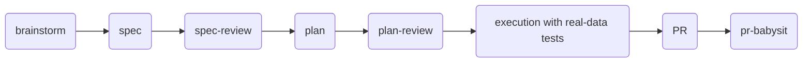
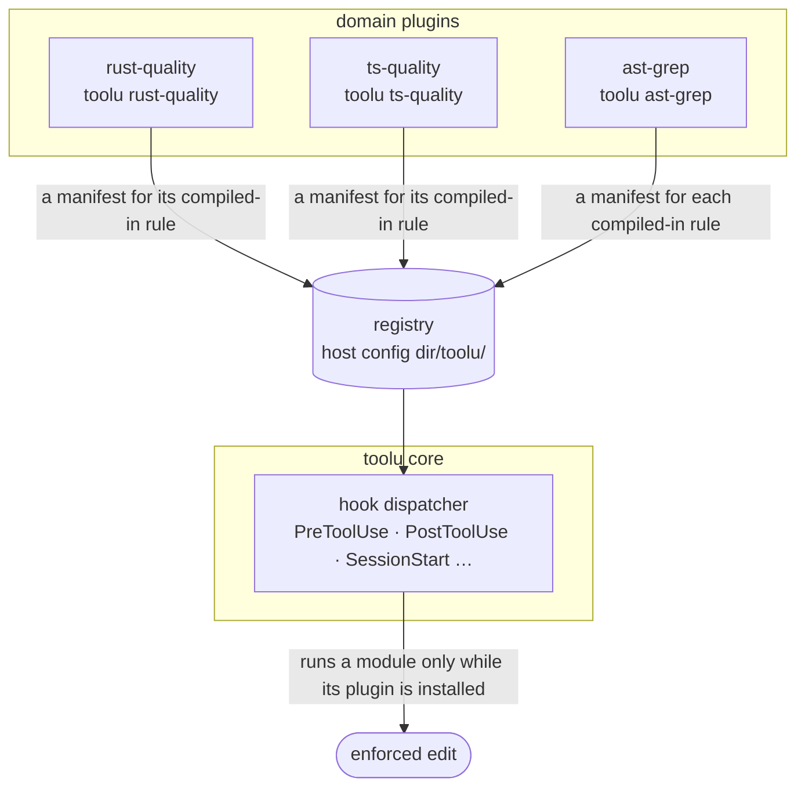

<div align="center">

# toolu

### Engineering discipline, wired into your AI coding agent.

AI writes code fast — then skips the parts that keep a codebase alive: oversized files, swallowed errors, mock-only tests, undocumented exports, unreviewed pushes. **toolu** bakes that discipline back in — as hooks that gate every edit, skills that enforce an adaptive design-to-delivery workflow, and a plugin registry so language-specific rules ride along automatically. Runs on **Claude Code and Codex**.

[](https://github.com/Falconiere/toolu/releases)
[](./LICENSE)
[](#testing)
[](#install)
[](#contributing)

[Why](#why) · [The quality gate](#the-quality-gate) · [Install](#install) · [What's inside](#whats-inside) · [Delivery workflow](#delivery-workflow) · [Architecture](#architecture) · [Configuration](#configuration)

</div>

---

## Why

Your AI coding agent is a superb pair-programmer, but left alone it optimizes for *getting the change in*, not for the conventions that make a change safe to keep. You end up re-typing the same review feedback every session: *split that file, don't swallow that error, that test is all mocks, document the export, don't push that unreviewed.*

toolu moves those rules out of your head and into the tool:

- **Hooks enforce on every edit** — a post-edit quality gate checks each file the agent touches and **blocks the session from moving on while any error, warning, or test failure exists** — even in unrelated files.
- **Skills enforce a process** — one delivery-flow skill with write/review checkpoints before execution, so design happens before code and review happens before delivery.
- **A registry keeps it modular** — drop in a domain plugin (Rust rules, TypeScript rules, structural search) and its hook modules register themselves into the core engine, fail-closed, with zero wiring.

It's a personal bundle, built in the open, MIT-licensed. Take the whole thing or lift the pieces you like.

## The quality gate

The headline feature. When `rust-quality`, `ts-quality`, and/or `python-quality` is installed, every Rust/TypeScript/Python file the agent edits is checked on the spot. Limits are **config-driven** (project/user override → the active native linter's `max-lines` → built-in default), and the gate is **multi-slot**: a failing test command and a failing file check are tracked independently, so fixing one never silently masks the other.

<table>
<tr><th align="left">TypeScript</th><th align="left">Rust</th><th align="left">Python</th></tr>
<tr valign="top"><td>

- File / function line limits
- No `../` relative imports — use the `@/` alias
- No `as` type assertions — use a type guard
- No hand-rolled type guards — use a Zod schema
- Tests colocated in a flat `__tests__/`
- Duplicate-type detection across the tree
- "Does too much" / too-many-factories heuristics

</td><td>

- File / function / `impl` line limits
- No `.unwrap()` / `.expect()` — use `?` or `match`
- No `unsafe` blocks
- No `#[allow]` / `#[expect]` lint suppression
- Tests in `tests/`, never inline `#[cfg(test)]`
- Flat `tests/` layout enforced

</td><td>

- File / function line limits
- No bare `except:` / one-line `except: pass`
- No blanket `# noqa` / `# type: ignore`
- No mocks in `test_*.py` / `*_test.py`
- Tests colocated as `test_*.py` next to the module
- Docstrings on public `def`/`class` (advisory)

</td></tr>
</table>

The rule isn't "warn and move on" — it's a hard gate: **no new task while the gate is red.** Found a real problem? Fix it in code. (There's no "disable this check" escape hatch by design.)

## Install

Install the native `toolu` binary with the installer or Homebrew, then the plugins:

```bash
curl -fsSL https://get.toolu.sh/pkg/toolu/install | bash   # macOS and Linux, arm64 and amd64
brew install falconiere/tap/toolu                          # or Homebrew, macOS and Linux
toolu plugins install
```

The installer verifies the release's minisign signature and the archive's
checksum before it writes anything. Upgrade, uninstall, a pinned version,
rollback and installing from a fork: **[docs/install.md](docs/install.md)**.
The npm package `@toolu/plugins` is deprecated and does not install toolu.

toolu supports Claude Code, Codex and Muse Code. Codex support covers
the CLI, IDE extension, and ChatGPT desktop Codex on macOS and Linux. Muse Code
is installed through `toolu plugins install --host muse`; see
[docs/install.md](docs/install.md#on-muse) for the install, approve and verify steps.
OpenCode V2 is installed through `toolu plugins install --host opencode`; see
[docs/opencode.md](docs/opencode.md).

**Prerequisite:** the native `toolu` binary. Every hook, skill command and agent command runs it; Bun is not used or needed on any host. Resolution order, missing-binary behaviour, and rationale: [docs/runtime.md](docs/runtime.md).

### The plugin installer

`toolu plugins` installs the plugins: it drives each host's own plugin CLI in
catalog dependency order.

```bash
toolu plugins install              # everything, core first
toolu plugins install rust-quality # one plugin and its dependency
toolu plugins list                 # catalog joined with what is installed
toolu plugins remove jev --yes
toolu plugins update               # every host with toolu plugins, no prompt
```

Claude Code, Codex and Muse are the supported hosts. Full grammar, exit codes, and
the `.toolu/plugins.json` selection file:
**[docs/cli/installer.md](docs/cli/installer.md)**.

### Install everything

One command per host. It adds the marketplace and installs every plugin in the
catalog, core first, deriving that order from the catalog's own dependency
edges. Do not install comemory — it has moved to its own installer (below).

#### Claude Code

<!-- install-everything:claude -->
```bash
# Optional: lets Claude Code resolve the code-simplifier companion. Nothing is
# installed from it; skip if you do not want the pre-simplify pass.
claude plugin marketplace add anthropics/claude-plugins-official

# Adds the toolu marketplace and installs every catalog plugin, core first.
# Already-installed plugins are reported and left alone.
toolu plugins install
```
<!-- /install-everything:claude -->

#### Codex

<!-- install-everything:codex -->
```bash
# Adds the toolu marketplace and installs every catalog plugin, core first.
toolu plugins install --host codex
```

After they are installed, review and trust the hooks in `/hooks` before they run.
<!-- /install-everything:codex -->

> **Note** — `delivery-flow` depends on `toolu`, `toolu-review`, `pr-babysit`, and `brainstorm`; `epic-orchestrator` uses `delivery-flow`. Quality plugins, `pr-babysit`, `documentation-gate`, and `git-better` depend on `toolu`. The `push-review` gate is **reviewer-agnostic**: the built-in `/code-review` skill satisfies it, as does the `toolu-review:review` skill.

> **Deprecation:** comemory host integration now lives in
> [Falconiere/comemory](https://github.com/Falconiere/comemory). First obtain a
> current comemory binary and verify `comemory install --help`; then run
> `comemory install claude` or `comemory install codex`. After that succeeds,
> disable the legacy plugin with `/plugin uninstall comemory@toolu` or
> `codex plugin remove comemory@toolu`.

To migrate an existing legacy installation, obtain the standalone `comemory` binary:

```bash
brew install Falconiere/tap/comemory   # macOS + Linuxbrew (canonical)
# or the curl installer:
curl --proto '=https' --tlsv1.2 -LsSf https://github.com/Falconiere/comemory/releases/latest/download/comemory-installer.sh | sh
```

Plugins that depend on the core detect a missing installation at SessionStart
and print the exact repair command: `codex plugin add toolu@toolu`.

Codex discovers the same canonical workflows as namespaced skills:

- `$toolu:commit`, `$toolu:review-and-commit`
- `$statusline:status`
- `$brainstorm:brainstorm` to think a change through without delivering it
- `$delivery-flow:delivery-flow` for checked delivery
- `$pr-babysit:babysit`
- `$documentation-gate:sync` for a routed documentation review
- `$git-better:git-better` to write semantic commits and branch names
- `$toolu:setup` to preview, install, update, back up, or remove the five bundled Codex agent profiles

Codex requires explicit hash-based trust before plugin hooks execute. Review and
trust the installed hooks through Codex's `/hooks` interface after installation;
a changed hook must be trusted again. Codex cloud and Windows are not supported
in this release. Custom agent profiles are installed locally under
`${CODEX_HOME:-~/.codex}/agents`, so they are also unavailable in Codex cloud.

## What's inside

Sixteen plugins, one marketplace. Every plugin ships synchronized Claude and
Codex manifests, and release-please holds all of them — plus the workspace
packages and the root — at one version matching the git tag, so a plugin's
version is always the repository's. Install the core alone, or add the domain
plugins.

| Group | Plugin | What it does |
|--------|--------|--------------|
| Core | **`toolu`** | Registry-driven hook engine, commit workflows, model routing, push-review gate, and custom-agent templates. |
| Quality gate | **`rust-quality`** | Rust post-edit checks — size limits, `.unwrap()`/`.expect()` bans, no `unsafe`, no lint suppression, flat real-data tests. |
| Quality gate | **`ts-quality`** | TypeScript post-edit checks — size limits, imports, type assertions/guards, duplicate types, and colocated real-data tests. |
| Quality gate | **`python-quality`** | Python post-edit checks — size limits, no suppression (bare `except:`/`# noqa`/`# type: ignore`), docstrings, colocated real-data tests. |
| Code intel | **`ast-grep`** | Structural code search and rewrite plus a registry-driven text-to-AST nudge. |
| Knowledge | **`jev`** | Typed judgments from TypeSafe's Jev model — probabilities, choices, and scores a script can branch on. |
| Workflow | **`documentation-gate`** | Jev-routed editing worker and committed-diff documentation review. |
| Workflow | **`toolu-review`** | Pre-push review matching CI `code-review@v8` (Jev-enabled) and writing review attestations. |
| Workflow | **`code-review`** | Native local review of the push diff (OpenRouter + Jev, epic #660); today the `toolu code-review run` contract, failing closed until the pipeline lands. |
| Workflow | **`brainstorm`** | Evidence-backed design triage, alternatives, and a recommended approach — standalone, and phase 1 of delivery-flow. |
| Workflow | **`delivery-flow`** | One public skill for brainstorm through PR and babysit, with private phase guidance. |
| Workflow | **`pr-babysit`** | Strict PR clearance through Claude cron or a durable Codex goal with isolated worktrees. |
| Workflow | **`epic-orchestrator`** | Drive a GitHub, Jira, or Linear epic to merged PRs via herdr workers on any host, dependency waves, and a merge gate with auto-merge. |
| Workflow | **`git-better`** | Semantic branches and commits agents can read: scoped Conventional Commit subjects with an `Intent:` trailer and `<type>/<ref>-<slug>` branch names, checked before git runs. |
| Environment | **`sandbox`** | A Linux place for builds, gates and agent CLIs: `toolu sandbox run` on a Lima VM that mounts only the project (macOS) or this machine (Linux). |
| Status | **`statusline`** | Persistent Claude statusline plus an explicit Codex repository/gate status report. |

Beyond the plugins, the core (`toolu`) also ships:

- **\`push-review\` gate** — blocks \`git push\` on a feature branch until the diff has been run through an accepted reviewer (the built-in \`/code-review xhigh --fix\` skill or the \`toolu-review:review\` skill), with a round cap (5 rewrites against an unchanged diff) that escalates instead of looping forever. The state file lives under the pushed repo's own root, so `git -C <worktree> push` is gated on the worktree's branch and diff.
- **docs-sync backstop** — checks documentation on push using the configured gate mode. With `documentation-gate` active, it requires a current committed-diff worker review; otherwise it uses the legacy documentation-surface check. See [config](docs/config.md#documentation-sync-with-documentation-gate).
- **Commit workflows** — Claude exposes `/commit` and `/review-and-commit`; Codex exposes `$toolu:commit` and `$toolu:review-and-commit`. Both read the same canonical workflow files, preventing host drift.
- **Model routing** — delegated work is tiered by its *class*, not its phrasing. Claude defaults to Haiku/Sonnet/Opus aliases; Codex defaults to Luna/medium for mechanical work, Terra/medium for exploration and implementation, Terra/high for review, and Sol/high for synthesis and architecture. Both mappings are configurable in [config](docs/config.md#model-routing-models).
- **Tier-pinned agents** — Claude reads the bundled agent definitions directly. `$toolu:setup` manages Codex TOML profiles for `quick-task` (Luna/medium, read-only), `deep-explore` and `research-agent` (Terra/medium, read-only), `implementer` (Terra/medium, workspace-write), and `architect` (Sol/high, read-only), with previews, conflict refusal, timestamped backups, and recoverable removal.

## Delivery workflow

Install `delivery-flow@toolu`, then invoke `/delivery-flow:delivery-flow` in Claude Code or `$delivery-flow:delivery-flow` in Codex. Invocation authorizes commit, push, PR creation, and babysit after the gates pass. The single public skill reads private phase references, runs `brainstorm` as phase 1, and runs every phase, including for small fixes: brainstorm → spec → spec review → plan → plan review → execution with real-data tests → PR → babysit.



To think a change through without starting delivery, invoke `/brainstorm:brainstorm` (Claude Code) or `$brainstorm:brainstorm` (Codex). It posts a capsule in chat — outcome, defaults, evidence, risk, next step — and writes `docs/toolu/brainstorms/<date>-<slug>.md` only on its Full path or when you ask.

Spec and plan reviews must approve before the next phase. The execution phase verifies ledger steps, real-data tests, documentation, local review, and the green verdict. A rejection or failed check stops the flow at that phase; resume there and refresh stale evidence. Missing GitHub auth, a non-default branch, a dependency, or a gate is reported as a specific delivery blocker.

The workflow skills and `ast-grep` run native `toolu` commands. The standalone `deep-research` skill uses the active host's native web tools for cited reports under `docs/research/`.

## Architecture

Everything a plugin ships lives under its own `plugins/<name>/` directory — no symlinks, no content outside the plugin root — so a marketplace install gets the whole working tree. Domain plugins contribute hook modules to the core dispatcher through a **runtime registry**:



At `SessionStart`, `ts-quality`, `python-quality`, `rust-quality`, `ast-grep`, `documentation-gate` and `git-better` register manifests (`<plugin-spec>__<name>.json`) that enable rules compiled into `toolu`. The core runs a module **only while the owning plugin is installed** — uninstall the plugin and its rules vanish, fail-closed. See [docs/registry.md](docs/registry.md).

<details>
<summary><b>Full repository layout</b></summary>

```text
.
├── docs/                       # Runtime config schema, design notes
└── plugins/
    ├── toolu/                  # Core plugin: hook engine + process gates
    │   ├── .claude-plugin/     # Claude Code plugin.json manifest
    │   ├── .codex-plugin/      # Codex plugin.json manifest
    │   ├── skills/             # core orchestration, debug, research, and command skills
    │   ├── agents/             # quick-task, deep-explore, research-agent, implementer, architect
    │   ├── commands/           # commit, review-and-commit
    │   ├── hooks/              # PreToolUse / PostToolUse / SessionStart hook entries
    │   └── settings/           # reusable settings fragments
    ├── ast-grep/               # ast-grep skill + nudge and byte-savings rules, native manifests
    ├── jev/                    # jev skill + TypeSafe System One REST wrapper
    ├── rust-quality/           # Rust PostToolUse quality checks, a native rule manifest
    ├── ts-quality/             # TypeScript PostToolUse quality checks, a native rule manifest
    ├── python-quality/         # Python PostToolUse quality checks, a native rule manifest
    ├── statusline/             # optional gate-aware statusline + SessionStart symlink hook
    ├── brainstorm/             # brainstorm skill + design question bank
    ├── delivery-flow/          # one public skill, private phase references
    ├── documentation-gate/    # routed documentation worker and review gate
    ├── pr-babysit/             # Claude command + Codex skill + strict shared workflow
    ├── toolu-review/            # toolu-review:review skill + push-review state writer
    ├── code-review/             # native code-review plugin manifests (skill lands with #669)
    ├── sandbox/                 # toolu sandbox: a Linux VM (Lima) or the host for builds and agent CLIs
    ├── git-better/              # semantic-git rule: semantic commit messages and branch names
    └── epic-orchestrator/       # resident epic engine, merge queue and tracker verbs
```

</details>

## Configuration

Toggle individual skills, hooks, or MCP servers without uninstalling anything.
Claude uses `~/.claude/toolu.config.json` and `<repo>/.claude/toolu.config.json`;
Codex uses `${CODEX_HOME:-~/.codex}/toolu.config.json` and
`<repo>/.codex/toolu.config.json`. `TOOLU_CONFIG_DIR` and
`TOOLU_PROJECT_CONFIG_DIRNAME` override both roots. Defaults are opt-out — no
file required.

```json
{
  "version": 1,
  "skills": { "comemory": false }
}
```

Quality-gate thresholds (file/function/impl line limits) are configurable per project and per language. Full schema and examples: [`docs/config.md`](./docs/config.md).

## Testing

The hook engine and language gates are covered by Rust tests that spawn the real `toolu` binary, all run in CI on every push. Install smoke tests use temporary host configuration roots:

```sh
cargo xtask gate                    # the quality gate
cargo test --workspace             # every Rust test
cargo xtask host-smoke --host both  # macOS live check of both hosts
```

## Contributing

PRs and issues welcome.

1. Pick the right home — skill vs. agent vs. command vs. hook — and use the existing siblings as templates.
2. Add Rust tests (`tests/<module>_test.rs` beside the module, or a crate's `tests/`) for hook logic.
3. Verify in a real session before committing.
4. Use a [Conventional Commits](https://www.conventionalcommits.org/) subject (`feat(skills): add foo`).

## Releases

Releases are automated with [release-please](https://github.com/googleapis/release-please) — you do **not** bump versions or tag by hand. The repo ships as **one version**: `toolu` and every plugin share the same `vX.Y.Z`.

- Merge Conventional Commits to `main`. release-please maintains one batched **Release PR** for the whole repo. **Any** path counts — a `feat` in `tooling/` or `.github/` releases just like one under `plugins/`.
- `feat` / `fix` / `feat!` (or `BREAKING CHANGE`) drive minor / patch / major bumps; `chore` / `docs` / `ci` / `refactor` ship no release.
- Review the Release PR, then **merge it to cut the release** — the only manual step. It bumps root `package.json`, the npm wrapper package, `Cargo.toml` / `Cargo.lock`, and every Claude, Codex and Muse plugin manifest, updates `CHANGELOG.md`, and creates a draft release with a `vX.Y.Z` tag. Four native builds run first and the GitHub release becomes public only after the native archives, checksums, SBOM, and platform smoke tests pass; npm then publishes the deprecated `@toolu/plugins` notice, which ships no binary, and the native builds never wait for npm. The marketplace re-extracts a plugin when its manifest version changes. See [the native release runbook](docs/releases/native.md) for dry runs and recovery.

## References

- [Claude Code docs](https://docs.claude.com/en/docs/claude-code) ·
  [Skills](https://docs.claude.com/en/docs/claude-code/skills) ·
  [Subagents](https://docs.claude.com/en/docs/claude-code/sub-agents) ·
  [Slash commands](https://docs.claude.com/en/docs/claude-code/slash-commands) ·
  [Hooks](https://docs.claude.com/en/docs/claude-code/hooks) ·
  [Plugins](https://docs.claude.com/en/docs/claude-code/plugins)
- [Codex plugins](https://developers.openai.com/plugins/build/plugins) ·
  [Hooks and trust](https://learn.chatgpt.com/docs/hooks) ·
  [Custom subagents](https://learn.chatgpt.com/docs/agent-configuration/subagents)

## License

[MIT](./LICENSE) © [Falconiere Barbosa](https://github.com/falconiere)
